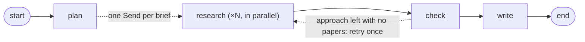

# Multi-Agent Research Assistant with LangGraph
#### Tiziana Ligorio for *AI Agents - CSCI 395.32* taught at Hunter College of The City University of New York

In this tutorial we build a research assistant that answers **comparison questions** from the scientific literature on arXiv: questions that ask how several methods, techniques, or approaches compare. Each approach is researched by its own subagent, in parallel, and the answer is a short comparison table with supporting papers. The system is built with **LangGraph** and compared against a single agent that does the same job alone.

## How it works

1. **plan** splits the question into one brief per approach.
2. **research** runs one subagent per brief, in parallel. Each searches arXiv in its own context and returns one row of the table.
3. **check** (plain code) removes any citation that did not come from that researcher's own searches, and sends back an approach left with no papers.
4. **write** reads all the rows and writes a short summary.

## What you will learn

1. When a task justifies more than one agent, and how to measure what the split costs against a single-agent baseline.
2. How to build a LangGraph graph: shared state, reducers, nodes, edges, conditional edges, and parallel branches with `Send`.
3. How to use agents as nodes: research subagents built with `create_agent`, each with its own brief, tool, and isolated context.
4. How to read the trace of a parallel run, and how to compare the system with a single agent.

The tutorial uses `openai/gpt-4.1-mini` through [OpenRouter](https://openrouter.ai) and the free [arXiv API](https://info.arxiv.org/help/api/index.html). Search results are cached in `arxiv_cache.json`, so reruns are fast and do not depend on arXiv's rate limits.

## Getting Started

### Option 1: Run in Google Colab (Recommended for quick start)

Click the badge above to open the notebook directly in Google Colab.

### Option 2: Run Locally

For local installation, clone this repository and follow the instructions in [SETUP.md](SETUP.md).
